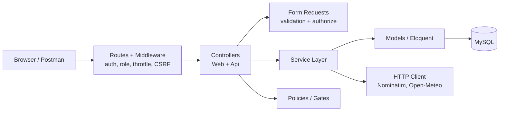

# Architecture



| Layer | Responsibility |
|---|---|
| Routes + middleware | Authentication (session / Sanctum), `role:` check, rate limiting, CSRF. |
| Controllers | HTTP only: read request, call a service, return view/JSON. No business rules. |
| Form Requests | Input validation + `authorize()` via policies. |
| Policies | Who may view/update/delete a shipment (customers: own only). |
| `ShipmentService` | Create/update/delete, number generation, search/filter/sort/paginate, audit. |
| `TrackingService` | Append events, validate time order and status transitions (state machine in `ShipmentStatus`), set actual arrival. |
| `EtaService` | Deterministic ETA/delay rule + severity + human-readable reason. |
| `ExceptionService` | Exception lifecycle OPEN -> INVESTIGATING -> RESOLVED, timeline events, notifications. |
| `DashboardService` | All dashboard/report numbers from DB queries. |
| `GeocodingService`, `WeatherService` | External APIs; timeout, HTTP error and empty-result handling, cached. |
| `AuditService`, `NotificationService` | Audit trail and in-app notifications. |

## Delay rule

```
delay_hours = (actual_arrival ?? estimated_arrival) - expected_arrival
is_delayed  = delay_hours > 0 AND delay_hours >= DELAY_THRESHOLD_HOURS   (group parameter)
severity    = LOW (<=6h) | MEDIUM (<=24h) | HIGH (>24h)                  (configurable)
```
