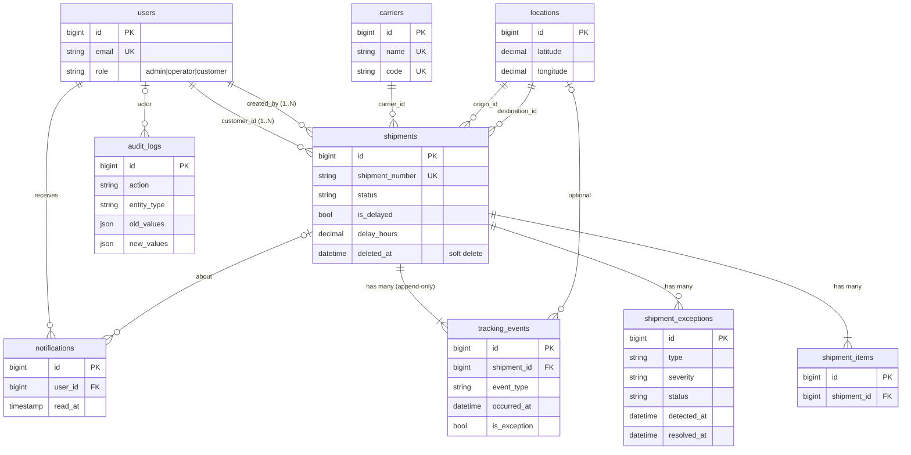

# ERD

## Design decisions

| Decision | Reason |
|---|---|
| `shipments.customer_id -> users` (N:1) | A customer owns many shipments; ownership drives authorization (customers only see their own). |
| `shipments` has two FKs to `locations` (origin/destination) | A location can be origin of many shipments and destination of many others. |
| `tracking_events` is **hasMany** and append-only | Tracking is historical: new status never overwrites old events; timeline = ordered events. |
| `shipment_items` hasMany, cascade delete | Item lines have no meaning without their shipment. |
| Soft delete only on `shipments` | Audit/history must survive deletion; other tables are reference/log data. |
| `ON DELETE RESTRICT` for customer/carrier/locations | Prevents orphaning shipments; the UI blocks deletion and suggests deactivating. |
| Indexes: `status`, `is_delayed`, `expected_arrival`, `(carrier_id,status)`, `(shipment_id,occurred_at)` | Dashboard counts, filters, sorting and timeline queries. |
| Unique: `shipment_number`, `carriers.name/code`, `users.email`, `locations(name,city,country)` | Business identifiers must not duplicate. |
| `status`/`type`/`severity` stored as strings, validated by PHP backed enums | Portable (MySQL + SQLite tests) and the state machine lives in code (`ShipmentStatus`). |
